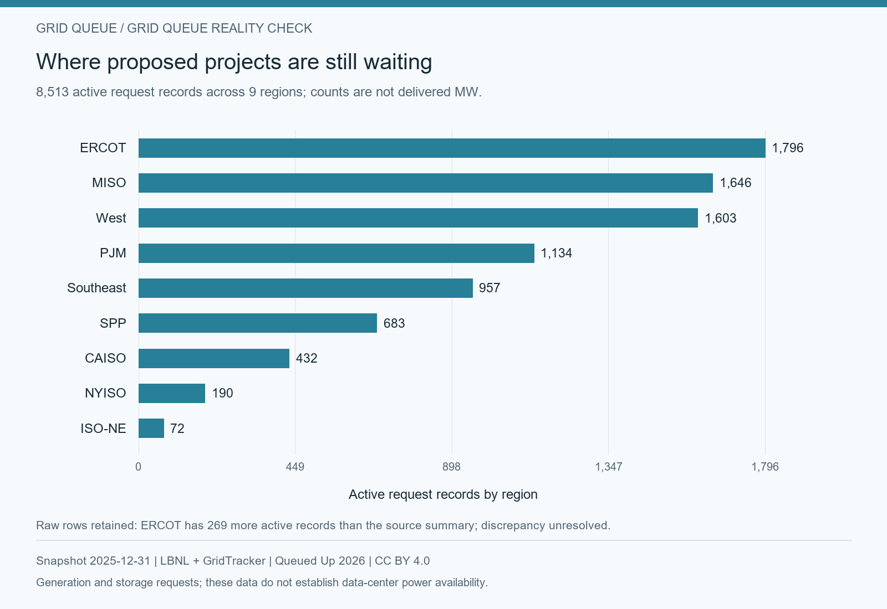
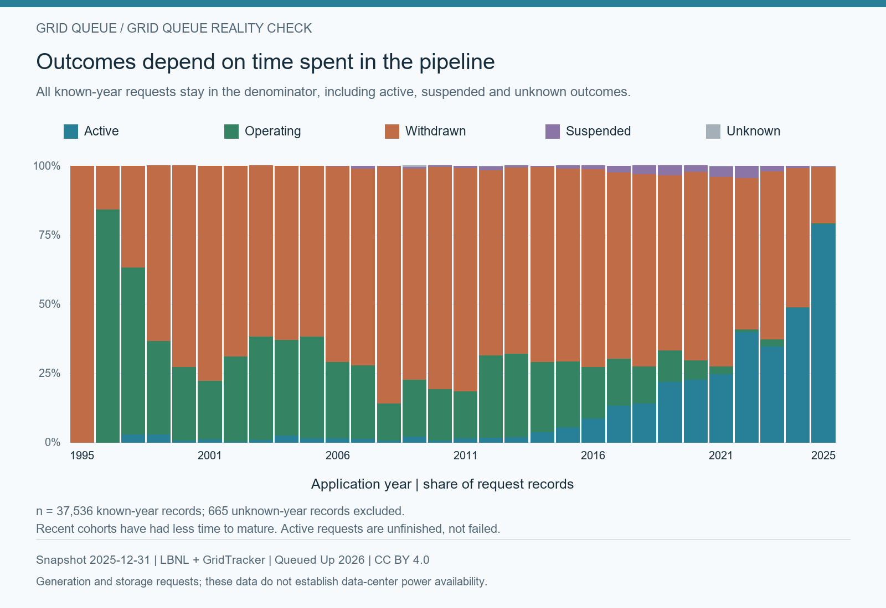
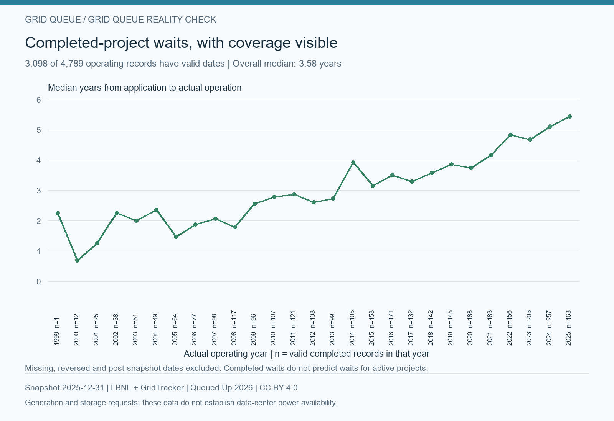

Grid Queue Reality Check - which proposed power projects actually reach the grid

See which proposed U.S. power projects reached operation, withdrew, remain active, or were suspended. Filter a local dashboard by region, technology and application year, then compare request outcomes and observed waits for completed projects.

The app ships with a **298 KB compressed public extract containing all 38,201 request records** from Berkeley Lab's May 2026 *Queued Up* workbook, covering the queue snapshot at **December 31, 2025**. The default dashboard and tests work offline after installation. No account, API key or credentials are needed.

## Why it matters

A proposed project is a place in a pipeline, not delivered electricity. Request counts, capacity and completed wait times answer different questions. The dashboard keeps these measures separate and shows the records excluded from each calculation. This makes it useful for learning about infrastructure backlogs and operations measurement.

**This dataset covers generation and storage interconnection requests. It cannot establish when a data center will receive power.** It does not contain load interconnection queues.

## Quick start

Use Python 3.12. From the project folder, on Windows PowerShell:

```powershell
python -m venv .venv
.\.venv\Scripts\python.exe -m pip install -r requirements.txt
.\.venv\Scripts\python.exe -m streamlit run app.py --server.address=127.0.0.1 --browser.gatherUsageStats=false
```

On macOS/Linux:

```sh
python3.12 -m venv .venv
.venv/bin/python -m pip install -r requirements.txt
.venv/bin/python -m streamlit run app.py --server.address=127.0.0.1 --browser.gatherUsageStats=false
```

Open the local URL printed by Streamlit (usually `http://localhost:8501`). No download is required: the recorded CSV is included. Choose regions and exact technology labels in the sidebar; an empty selection means all values. Enable the application-year filter only if you want to exclude records with an unknown application year.

## Dashboard

- **Active backlog:** request counts by region, plus separate known generation and storage MW.
- **Cohort outcomes:** outcome shares by application year, retaining active, suspended and unknown requests in the denominator.
- **Completed wait times:** application-to-operation duration for operating records with valid actual dates; counts are shown beside annual medians.
- **Data & quality:** missingness, duplicate identifiers, source checksums and interpretation notes. Export the filtered records below the views.

## Showcase

Regenerate these PNG reports offline from the bundled extract. They use the same normalization and metric functions as the dashboard:

```powershell
.venv/Scripts/python.exe -m showcase --showcase docs/showcase
```



Active request counts reveal where proposed projects remain waiting, with the unresolved source-summary discrepancy disclosed.



Cohort shares retain unfinished requests so recent application years are not treated as failed projects.



Observed completed waits show delivery time alongside annual sample counts and excluded-date coverage.

These are generated analytical reports, not browser screenshots. Each is 1600 x 1100 pixels. Pillow renders them locally without a browser or network connection.

## Offline command line

Build a persistent DuckDB database from the included public CSV, then print its summary:

```powershell
.\.venv\Scripts\python.exe -m queue_pipeline build
.\.venv\Scripts\python.exe -m queue_pipeline summary
```

The dashboard reads the bundled records by default through an in-memory DuckDB connection. After a build, select **Local DuckDB snapshot** to read `data/queue.duckdb`. Connections close before dashboard interactions. Building replaces the three snapshot tables together in one transaction.

Example output, abbreviated:

```json
{
  "snapshot_date": "2025-12-31",
  "requests": 38201,
  "outcomes": {
    "withdrawn": 24221,
    "active": 8513,
    "operating": 4789,
    "suspended": 668,
    "unknown": 10
  },
  "valid_completed_waits": 3098,
  "median_completed_wait_years": 3.5824777549623548
}
```

The overall completed median combines completion years. It is not the median for projects completed in 2025 or a prediction for a new applicant.

## Download and import the source workbook

Only this explicit download step uses the network:

```powershell
.\.venv\Scripts\python.exe -m queue_pipeline download
.\.venv\Scripts\python.exe -m queue_pipeline build --workbook data/source.xlsx
.\.venv\Scripts\python.exe -m queue_pipeline reconcile data/source.xlsx
```

The download is pinned to the 2026 edition, validates the workbook and recorded checksum before replacement, and records the URL, retrieval time and SHA-256 in a receipt. If the publisher blocks an automated request, download the workbook manually from [Berkeley Lab](https://emp.lbl.gov/queues/) and pass its path to `build --workbook`. The importer recognizes the recorded workbook by checksum. For another file with compatible fields, supply `--snapshot YYYY-MM-DD` from its source documentation; its edition is marked unverified. New editions still need codebook and interpretation review before comparison. Importing does not modify the bundled compressed CSV or its manifest.

To rebuild the public extract and its dictionary from a downloaded workbook:

```powershell
.venv/Scripts/python.exe -m queue_pipeline extract data/source.xlsx --output data/rebuilt
```

Use a new or empty output directory. This writes an uncompressed CSV with the 14 selected public fields,
the source codebook, and a manifest with workbook and CSV checksums. Other source
columns are excluded. For an unrecognized compatible workbook, add `--snapshot`
as described above. Review the result before replacing versioned data. The bundled CSV uses standard gzip compression; its decompressed bytes match `csv_sha256` in the manifest.

## How it works

1. `data/public_queue.csv.gz` retains all workbook rows and 14 fields needed for these views. `data/codebook.csv` records the workbook's data dictionary. `data/manifest.json` records the edition, source URL, extraction scope and workbook/CSV checksums. The extract is a sample of 14 workbook fields, with every row retained; gzip keeps it under 1 MB without dropping records. Decompressed CSV integrity is checked on load against the original extraction checksum.
2. `grid_queue.py` maps the codebook's statuses into active, operating, withdrawn, suspended and unknown. Missing and unrecognized statuses remain unknown.
3. Identifiers encode provider (`entity`) and queue ID (`q_id`) as a structured pair so separators inside either field cannot create collisions. Colliding or missing IDs receive a source-row suffix. **All rows are preserved**, including exact repeated records. Row IDs trace back to Excel row numbers and are unique within this snapshot; they are not cross-edition plant IDs.
4. Each hybrid remains one request record. Its component types determine whether MW belongs to generation or storage (`Battery`, `Other Storage`). Known component MW is summed; missing, negative or nonfinite MW is not filled in, and incomplete component coverage is flagged. A component without a recognized codebook resource type is reported as unclassified and excluded from both capacity totals. Storage MW measures power, not MWh of energy.
5. Cohort shares use request counts, not MW. The denominator is every selected row with that application year, including suspended and unknown outcomes. Unknown years appear in the quality report and are excluded from the year chart.
6. Waits use `(actual operating date − application date).days / 365.25`. A record must be operating, have both dates, have nonnegative duration, and have neither date beyond the snapshot. Proposed online dates never substitute for actual completion. Annual wait charts group by **actual operating year**.

The small functions keep file loading, normalization, filters, calculations and persistence separate. The CLI uses the same calculations as the app.

## Tests

```powershell
.venv/Scripts/python.exe -m pytest -q
```

Run this from the project folder after installing the requirements. Use `.venv/bin/python -m pytest -q` on macOS/Linux.

After activating the environment, `python -m pytest -q` works on all platforms. GitHub Actions runs this command on Python 3.12. Tests use the recorded public CSV and small synthetic edge-case fixtures. A miniature Excel fixture exercises the actual workbook reader and summary reconciliation. Socket connections are blocked during tests. Streamlit's AppTest checks loading, filters and the empty-result state; DuckDB tests exercise disk roundtrips and metadata.

### Pipeline commands on Windows

From this folder, after installing the requirements, automation can use these exact commands without activating the environment:

```text
.venv/Scripts/python.exe -m pytest -q
.venv/Scripts/python.exe -m showcase --showcase docs/showcase
```

Windows virtual environments put Python in `Scripts`; macOS/Linux environments use `bin/python`. A missing executable error such as `WinError 2` occurs before tests start: check the interpreter path and create the environment using Quick start above. Invoke tools with `-m` through that interpreter so they use the installed project dependencies. CI checks tests and showcase generation on both Windows and Linux.

For this Windows checkout, the verified interpreter is
`C:/Users/Rohit/Portfolio/grid-queue/.venv/Scripts/python.exe`. The publishing
commands use that full executable path, so they do not depend on activation,
`PATH`, or a Unix-only `.venv/bin/python` path. If you move the checkout,
recreate `.venv` in the new folder and use its interpreter path. Python virtual
environments are local installation artifacts and are excluded from Git.

## Findings and limitations

See [the findings memo](docs/findings.md), [source attribution](data/NOTICE.md) and [recorded reconciliation](data/reconciliation.json).

- These are request records, not guaranteed independent physical plants. There are 270 rows involved in repeated provider/queue keys, and 54 repeated rows in the selected 14-field extract. We preserve and flag them because automatically merging records could erase distinct phases. Counts can overstate distinct projects.
- The summary-tab reconciliation matches 26 of 27 region/status counts. ERCOT has 1,796 active raw records versus 1,527 in the summary; the 269-record difference remains unresolved. The dashboard exposes raw counts rather than silently changing them.
- The report includes estimated hybrid storage capacity absent from the public project fields. Known-MW totals here will differ from headline estimates. Missing capacity never means a known zero.
- Missing historical outcomes and dates vary by provider. Observed completed waits describe projects with available dates; they do not estimate the time to completion of unfinished projects. Recent cohorts have had less time to mature.
- Source statuses are a historical snapshot, not today's queue. Counts do not establish causal reasons for withdrawal, future delivery, grid upgrade cost, or load service availability.
- The app does not include survival analysis, capacity-weighted cohort shares, historical edition comparisons or automatic refresh. The original workbook is downloaded locally and ignored by Git; the compact public extract is versioned.

## License

Code: [MIT](LICENSE), copyright 2026 Rohit Malla. The included data and dictionary are derived from the *Queued Up 2026* data file by Lawrence Berkeley National Laboratory and GridTracker, **CC BY 4.0**, and retain that attribution/license. The MIT code license does not relicense the source data.
