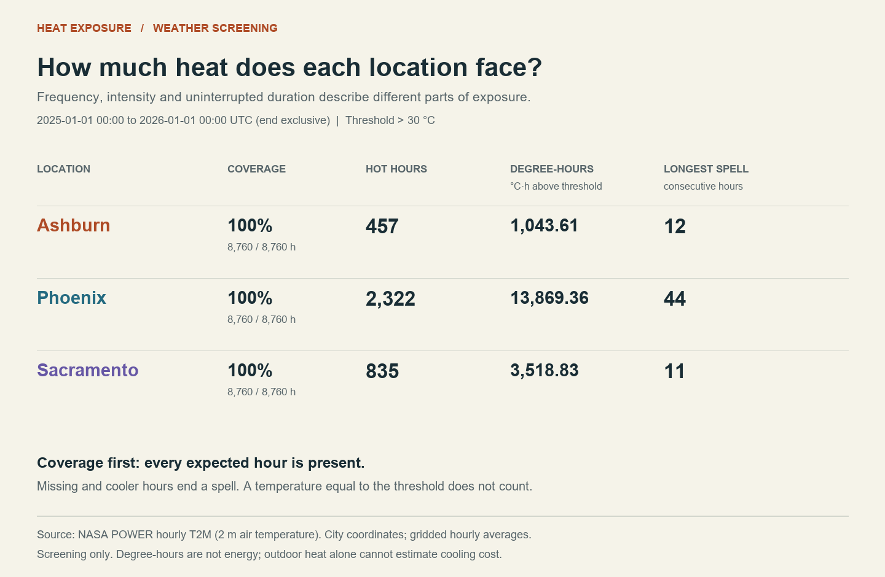
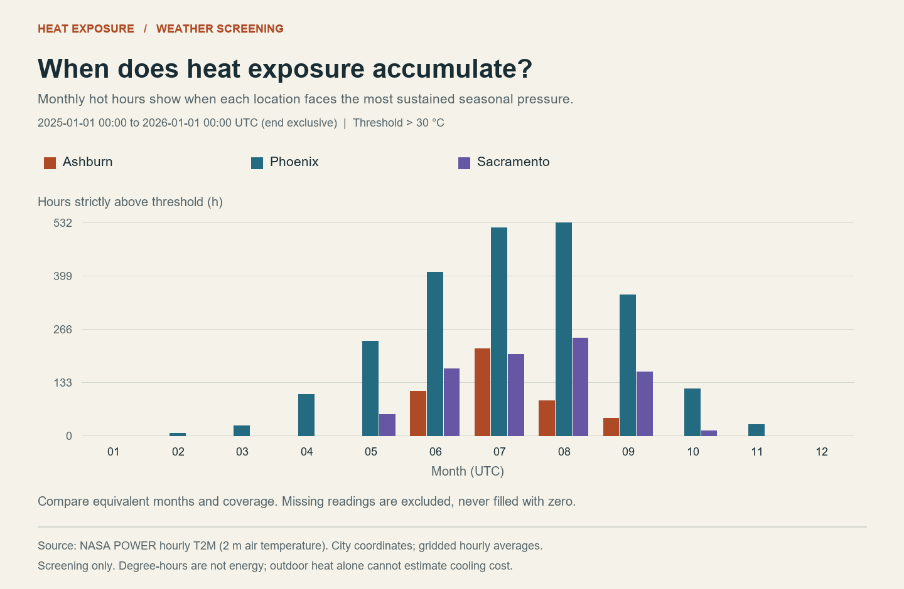
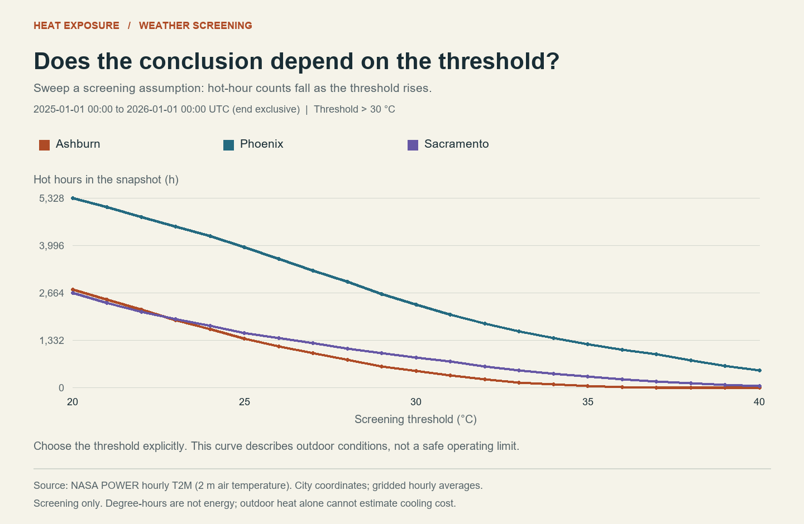

Data Center Heat Exposure Explorer — compare outdoor heat at candidate infrastructure locations.

# Heat exposure (part 1)

This part compares historical hourly temperatures in Ashburn, Phoenix and Sacramento. It reports hours above a chosen temperature, degree-hours above that temperature, the longest uninterrupted hot spell and monthly patterns. A static dashboard lets you adjust the threshold and download the results as CSV.

Outdoor heat is one input to infrastructure planning. Looking at duration and intensity helps explain why two locations with similar annual averages can present different operating conditions. **This is weather screening, not a cooling cost calculator or engineering design tool.**

## Quick start

Requires Python 3.12. The full 2025 sample is bundled; running reports, tests, the dashboard and the showcase requires no network access after installing dependencies.

```sh
python -m venv .venv
```

Activate the environment on Windows PowerShell:

```powershell
.venv\Scripts\Activate.ps1
```

Or on macOS/Linux:

```sh
source .venv/bin/activate
```

Then install and run:

```sh
python -m pip install -r requirements.txt
python -m unittest -v
python -m heat_exposure report
python -m heat_exposure build --output docs/site
```

Open [docs/site/index.html](docs/site/index.html) in a browser. This self-contained file also ships in the repository, so you can open it immediately without installing Python. It has no external scripts, fonts or network requests. JavaScript is required for the controls. Optionally serve it with `python -m http.server 8000 --directory docs/site` and visit `http://localhost:8000`.

## Example output

At the default screening threshold of **strictly above 30°C**, the bundled 2025 record gives:

```text
Location      Coverage   Hot hours   Degree-hours (°C·h)   Longest spell (h)
Ashburn       100%             457               1043.61                  12
Phoenix       100%           2,322              13869.36                  44
Sacramento    100%             835               3518.83                  11
```

Each location has 8,760 valid hours. Phoenix has the most exposure on all three measures at this threshold. Sacramento has more hot hours than Ashburn, but Ashburn's longest hot spell is one hour longer. The measures answer different questions; none alone determines the best facility location.

The CLI prints machine-readable JSON, including expected, valid and missing hours. To change the assumption, place global options before the subcommand:

```sh
python -m heat_exposure --threshold 35 report
python -m heat_exposure --threshold 35 build --output build/35C
```

The dashboard's slider updates the summary, monthly chart, monthly data table and downloadable CSV together. The CSV includes the selected threshold, period, coverage and all exposure metrics. Monthly longest spells reset at month boundaries; whole-snapshot spells can cross those boundaries.

## Showcase

Regenerate these three 1440 × 940 PNG reports offline from the bundled NASA sample:

```sh
python -m heat_exposure --showcase docs/showcase
```



Coverage, hot hours, degree-hours and longest spells show how the three locations differ at a 30°C threshold.



Monthly hot hours reveal when seasonal heat exposure builds at each location.



The threshold sweep shows how the comparison changes when the screening assumption changes.

## Data and reproducibility

The source is the public [NASA POWER hourly API](https://power.larc.nasa.gov/docs/services/api/temporal/hourly/), parameter **T2M**, hourly average air temperature at 2 meters in Celsius. All requests explicitly use **UTC**; NASA's default local solar time differs from civil time. UTC avoids daylight saving gaps and repeated local hours. Monthly groups are UTC months.

The bundled snapshot covers January 1 through December 31, 2025, at city reference coordinates in [data/sites.json](data/sites.json). These are not addresses of actual data centers. The normalized CSV is approximately 676 KB. [data/sample/manifest.json](data/sample/manifest.json) records the requested coordinates, exact request URLs, retrieval timestamps, raw response SHA-256 hashes, normalized CSV checksum, units and time standard. Upstream NASA records can change; the bundled checksum identifies the exact sample used here.

To download the same period again (this is the only command requiring network access):

```sh
python -m heat_exposure fetch --start 20250101 --end 20251231 --output build/new-snapshot
python -m heat_exposure --data build/new-snapshot report
```

Responses are cached by request URL in gitignored `data/raw/`. Use `--refresh` with `fetch` to bypass that cache. Requests have timeouts and bounded retries for temporary network/server failures. A fetch downloads all locations before writing the final normalized CSV and manifest. It never silently substitutes generated data. An interrupted write is detected by the CSV checksum on the next load.

For different locations, copy the site configuration to a JSON file, change the names/coordinates and use `fetch --sites path/to/sites.json --output build/custom`. Each site needs a unique lowercase slug `id`, a `name`, `latitude` and `longitude`. Fetch supports one calendar year or a shorter period per snapshot. The dashboard supports arbitrary site counts; the PNG comparison layout supports up to three. Do not commit raw downloads or large custom datasets.

## How it works

1. Validate the snapshot's checksum, units, time standard, site identifiers, timestamp range, duplicate hours and temperatures.
2. Load readings into an in-memory DuckDB table and query them in site/time order. Close the database before generating reports or accessing the network.
3. Align every location to the same expected hourly grid. Treat absent records, blank temperatures and NASA's declared fill value as missing. Never interpolate or treat a missing temperature as zero.
4. Calculate exposure with small Python functions. The dashboard uses equivalent JavaScript functions, checked against Python with hand-worked examples and the full sample at multiple thresholds.
5. Build a single HTML file with the hourly data embedded, or render actual report charts and a comparison table with Pillow.

Definitions, for a screening threshold `b`:

```text
Coverage       = valid hours / expected hours × 100
Hot hours      = count of valid hourly temperatures T > b
Degree-hours   = sum of max(T − b, 0) × 1 hour
Longest spell  = longest consecutive sequence of hot hourly readings
```

For `[30, 32, 35, missing, 34, 29, 31]` at 30°C: coverage is 6/7 (85.71%), hot hours are 4, degree-hours are 2 + 5 + 4 + 1 = 12°C·h, and the longest spell is 2 hours. A missing or cooler hour ends a spell. Equality with the threshold does not count. Whole-snapshot spells continue across month/year boundaries when hours are consecutive.

With incomplete coverage, counts and spell lengths describe observed exposure and are lower bounds. The dashboard shows the coverage warning rather than scaling partial data into an invented annual estimate.

## Tests and automated build

```sh
python -m unittest -v
```

Offline tests check hand-calculated metrics, equal-to-threshold readings, missing values and timestamps, duplicate rejection, year boundaries, checksum failure, source units, UTC, the bundled NASA results and PNG generation. If Node.js 18+ is available, the same command also checks Python/JavaScript agreement and executes dashboard threshold, monthly chart/table and CSV interactions using a small DOM adapter. Those two checks are explicitly skipped without Node. CI installs Node so they always run there. No test downloads weather or contacts NASA.

[The GitHub Actions workflow](../.github/workflows/check.yml) installs Python 3.12 dependencies, runs the offline suite, rebuilds the dashboard/images, checks tracked file sizes and uploads the generated `docs/` folder as an artifact. Dependency installation needs network access; tests and report builds do not. The workflow does not deploy. To use GitHub Pages, publish the `docs` directory from the repository's Pages settings; [docs/index.html](docs/index.html) links to the generated dashboard. No hosted deployment has been performed as part of this repository build.

## Limitations

- NASA POWER is gridded weather data, not a sensor at a facility intake. Hourly averages can hide brief peaks and local differences.
- One year is not a climate normal, a forecast or a design return period. Compare more years before drawing long-term conclusions.
- The threshold is an explicit screening assumption, not a required operating temperature, safety rating or cooling setpoint.
- Degree-hours are temperature exposure, not kWh. Humidity, equipment efficiency, IT load, water availability and tariffs are not modeled.
- Missing hours are excluded and break spells. Different coverage can make raw counts misleading; inspect coverage first.
- The browser dashboard has automated logic/interaction checks; a full browser visual/accessibility audit remains future work.
- PNG fonts may vary across operating systems. Calculations and labels are the same; pixel-for-pixel image hashes are not promised.

See [docs/walkthrough.md](docs/walkthrough.md) for a short technical walkthrough and next improvements. Code is under the [MIT License](LICENSE); NASA data remain subject to NASA's own [data access guidance](https://power.larc.nasa.gov/docs/).
